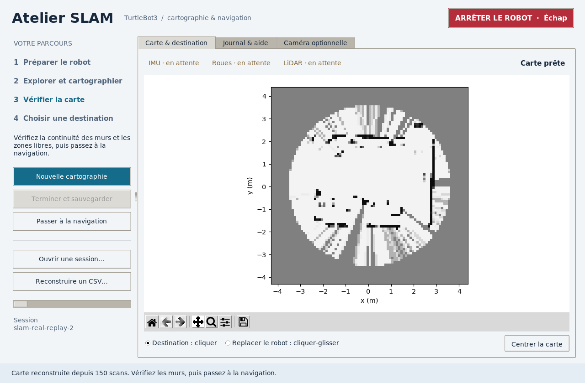

# Atelier SLAM : guide d’utilisation

L’application reste en **Tkinter/ttk**, avec une carte Matplotlib intégrée. Elle ne nécessite ni serveur web ni nouvelle bibliothèque graphique. Les traitements de cartographie et de navigation restent des processus supervisés ; les attentes de démarrage et de sauvegarde ne bloquent pas Tk.

## Lancer

Depuis la racine du projet :

```bash
./lancer.sh
```

Le lanceur charge ROS et vérifie les dépendances sans les réinstaller ni compiler. La commande historique `python3 manager.py`, depuis `atelier_slam`, utilise désormais le même lanceur. Une icône est installable avec `./scripts/installer_icone.sh`. Voir [lancement et diagnostic](LANCEMENT_ET_DIAGNOSTIC.md) pour l’installation initiale éventuelle et la correction du crash natif.

Préparer le pilote du TurtleBot sur le robot, avec un `ROS_DOMAIN_ID` commun aux deux machines. Les entrées attendues sont `/scan`, `/imu` et `/joint_states`. Le projet produit `/my_odom`. Vérifier que les paramètres physiques et les repères du pilote correspondent au robot ; la nouvelle interface ne configure pas le réseau ROS à votre place.



Cette capture provient d’une vraie fenêtre Tk sur un affichage virtuel isolé, avec une reconstruction d’acquisition historique. Les capteurs sont en attente car aucun robot n’était connecté.

## Parcours

1. **Nouvelle cartographie** crée une session unique et lance le contrôleur réactif et le cartographe, sans ouvrir RViz. Le robot attend une destination.
2. Garder le robot **immobile pendant la calibration IMU**. Les états IMU, roues et LiDAR se mettent à jour ; les destinations restent indisponibles pendant la préparation.
3. La carte apparaît progressivement. **Cliquer sur la carte** envoie une destination d’exploration au contrôleur réactif. Explorer lentement, en observant les obstacles ; repasser dans un lieu déjà parcouru permet de rechercher une boucle.
4. **Terminer et sauvegarder** arrête d’abord le contrôleur du robot puis le cartographe. Inspecter les murs et les zones libres. Le lancement de navigation reste une action explicite.
5. **Passer à la navigation** lance un producteur d’odométrie sans commande moteur et le contrôleur sur carte. Un clic choisit une destination. Le calcul de chemin considère les cellules inconnues comme bloquées et gonfle les obstacles pour le volume du robot.
6. **ARRÊTER LE ROBOT / Échap** reste accessible pendant les opérations. Cela arrête les processus supervisés. Une nouvelle action explicite est nécessaire pour repartir.

La barre de la carte permet de zoomer et de déplacer la vue. Désactiver l’outil de zoom/déplacement pour sélectionner une destination. **Centrer la carte** revient sur la zone explorée. Blanc = libre, gris = inconnu, noir = obstacle, orange = robot, bleu = trajet.

## Sessions et reprise

- **Ouvrir une session…** sélectionne un YAML associé à une session. Après lancement de navigation, **replacer le robot** dans la carte : sélectionner l’outil, cliquer à sa position, glisser dans sa direction. Les destinations attendent l’accusé de réception du contrôleur ; l’outil revient ensuite sur Destination.
- **Reconstruire un CSV…** copie l’acquisition dans une nouvelle session, reconstruit la carte et conserve la source d’origine. Pour naviguer sur cette reconstruction, replacer le robot également.
- Après arrêt et redémarrage de la navigation, replacer le robot également : le recalage manuel du contrôleur précédent ne doit pas être remplacé silencieusement.
- Les anciens CSV restent lisibles. Les anciens PGM/YAML sans convention validée doivent être régénérés.
- L’onglet **Journal & aide** explique les étapes et donne accès aux logs et à RViz. La **caméra** est facultative, dans son onglet séparé, avec un bouton de déconnexion.

## Logs de chaque run

Chaque démarrage du manager a un identifiant horodaté et aléatoire :

```text
atelier_slam/logs/manager_runs/<run_id>/
  console.log         # stdout, stderr, erreurs de démarrage du manager
  manager.log         # actions, démarrages, PID, chemins, sorties, traces d’erreur

atelier_slam/logs/sessions/<session_id>/
  session.json        # état, carte, CSV, lien vers le run et son manager.log
  mapping.csv         # scans bruts et poses synchronisées des nouvelles acquisitions
  navigation_*.csv    # acquisitions de navigation
  map_out.yaml        # métadonnées et transformation carte/odom
  map_out_*.pgm       # carte atomiquement référencée par le YAML
  preview.png         # aperçu courant
  slam_status.json    # diagnostic courant
  robot_status.json   # capteurs et calibration
  navigation_status.json
  pose_graph.json     # poses et contraintes, dont fermetures de boucle
  trajectory.csv     # trajectoire corrigée après optimisation
  debug/
    tb3_nav_node_<heure_id>.log
    carto_mat_<heure_id>.log
    nav_odom_<heure_id>.log
    rviz2_<heure_id>.log       # si RViz est demandé
    slam_events_<id>.jsonl
    ros/<launch_id>/          # logs ROS natifs des sous-processus
```

Chaque lancement de processus reçoit **son propre fichier**, même lorsqu’il est relancé dans la même session. La première ligne donne la commande exacte, le dossier de travail et le run du manager. `stderr` rejoint `stdout`, sans tampon Python ; les traces d’exception et de panne Python sont conservées. Les événements SLAM enregistrent pose brute, pose corrigée, transformation persistante, recouvrement, résidu, acceptation/refus, boucles et reconstruction.

Le bouton **Ouvrir les logs de ce run** ouvre le dossier debug de la session, ou celui du manager avant création de session. La barre de statut affiche aussi le chemin du journal du manager. Pour un lancement direct de `tb3_nav_node.py`, `carto_mat.py` ou `nav_odom.py`, un dossier unique est créé sous `logs/standalone_runs/`. `TB3_DEBUG_DIR` permet de choisir un autre dossier racine pour ces lancements directs. Aucun nettoyage automatique des logs n’est effectué.

En cas d’erreur, commencer par `manager.log`, puis le fichier du processus concerné, enfin `slam_events_*.jsonl` pour comprendre les refus de recalage. Les commandes et les chemins enregistrés peuvent contenir des informations propres à la machine : vérifier les fichiers avant partage.

## Vérifications effectuées et limites

Les tests vérifient le calcul, l’arrêt sur données périmées, les sessions, les messages d’interface et la construction des widgets. Une relecture de 150 scans historiques a produit carte, aperçu, graphe, trajectoire et logs. L’interface a été lancée et capturée sur un affichage virtuel, sans contrôleur physique.

**L’essai sur TurtleBot reste nécessaire** : vérifier les repères, la synchronisation des horloges, les seuils de recalage, la latence, le passage cartographie/navigation et l’arrêt. Les messages locaux expirent au bout de trois secondes et chaque démarrage de contrôleur reçoit un jeton distinct, pour éviter la réutilisation de commandes anciennes.
